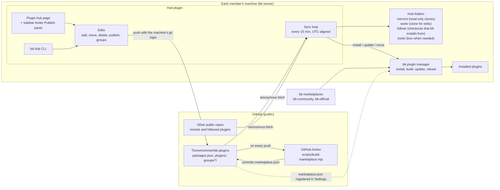
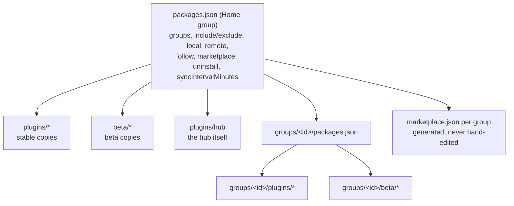
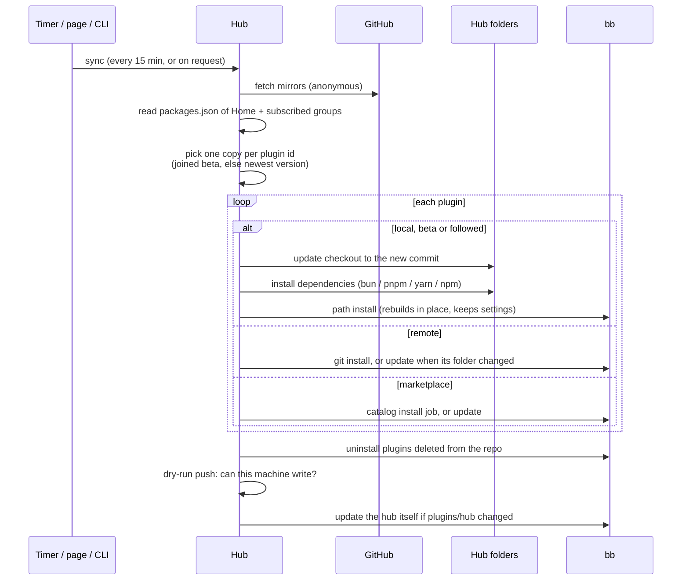
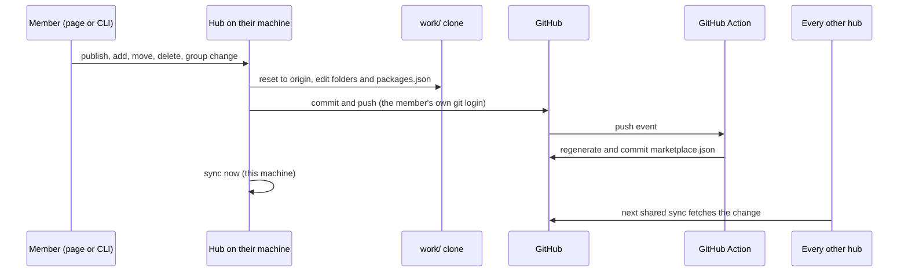
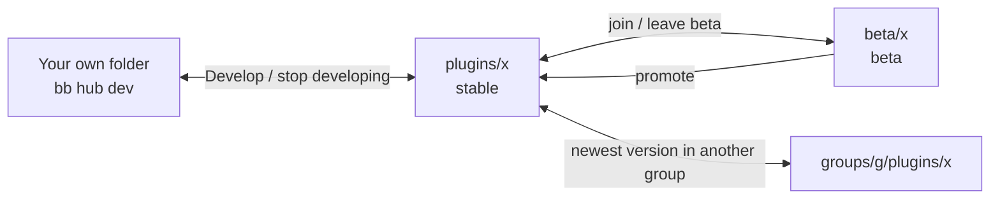

# Architecture

How the shared plugin repository, the **hub** plugin, and bb fit together.
Everything is public and token-free: hubs read anonymously, and the only
writes are pushes made with a member's own git login.

## Overview

## The repository

Each group lists what its subscribers install:

| Kind | Where it lives | How bb installs it |
|---|---|---|
| **Local** | A folder in this repo (`plugins/<name>`, or `local` for one owned by reference) | Path install from the hub's checkout of this repo |
| **Beta** | `beta/<name>` in a group | Same, only on machines that joined that plugin's beta |
| **Remote** | Another public repo (`remote`) | bb's own git install (`git:<url>[@ref]`) |
| **Followed** | Every plugin folder in another public repo (`follow`) | Path install from the hub's checkout, after installing workspace dependencies |
| **Marketplace** | An entry in a bb marketplace (`marketplace`) | bb's catalog install |

## One sync

Installs run as bb install jobs, so builds that take minutes don't time out;
a sync waits up to a minute, then shows the plugin as "installing".

## One change

If the member's git can't push, the page says why and greys out the buttons
that change the repository.

## Switching copies without losing data

Plugins from this repo and from followed repos are path installs from the
hub's checkouts. Moving a path install to another folder keeps its settings
and data, which makes these switches lossless:

A plugin installed from git before this (or from a marketplace) can't move
to a folder without a reinstall, which resets its data; the hub asks first.
